# OWASP ZAP — Lab Writeup

**Author:** Malith Lakshan Wijekoon
**Room:** TryHackMe — Introduction to OWASP ZAP (Cyber Security 101 → Offensive Security Tooling)
**Environment:** Kali Linux (VMware VM), ZAP 2.17.0, Firefox
**Test dates:** 2026-09-15 → 2026-09-18 (room 50% completed)
**Target:** `testfire.net` (Altoro Mutual — IBM's intentionally vulnerable demo banking site, Task 1/4 walkthrough) සහ room එකේ DVWA machine (manual scanning stage)

---

> **තත්ත්වය:** මේ writeup එක ZAP room එකේ **Task 1 (Intro), Task 2 (Disclaimer) සහ Task 4 (Automated Scan)** සාර්ථකව කරපු දේවල් සහ **Task 5 (Manual Scanning)** proxy/certificate setup එකේ ප්‍රගතිය document කරනවා. Room එක මේ වෙනකන් **50%** complete වෙලා — Directory Bruteforce, Authenticated Scan, Login Page Bruteforce, Extensions tasks තවම ඉතුරුයි.

---

## 1. අරමුණ (Objective)

OWASP ZAP (Zed Attack Proxy) — Burp Suite එකට free/open-source alternative එකක් — භාවිතා කරලා web application security testing මූලිකාංග ඉගෙන ගැනීම. විශේෂයෙන්:

- ZAP සහ Burp Suite අතර feature mapping එක තේරුම් ගැනීම
- Automated Scan එකක් (Spider + AJAX Spider + Active Scan) run කිරීම
- ලැබෙන Alerts විශ්ලේෂණය කිරීම
- Manual scanning සඳහා ZAP එක browser proxy එකක් විදියට configure කිරීම (Burp එකේ Intercept එකට සමාන)
- ZAP ගේ root CA certificate එක Firefox එකට import කිරීම, HTTPS traffic intercept කරගන්න

---

## 2. Task 1 — Intro to ZAP

Room එක ආරම්භ වෙන්නේ ZAP සහ Burp Suite අතර feature-to-feature mapping එකකින්. ZAP එකේ "Site Tree" = Burp ගේ "Site Map", "Request Editor" = "Repeater", "Fuzzer" = "Intruder" වගේ. ZAP එකේ ප්‍රධාන වාසිය — **සම්පූර්ණයෙන්ම නොමිලේ, open source** — Automated Scan, Web Spidering, Unthrottled Intruder වගේ Burp එකේ paid features ටිකක් ZAP එකේ නොමිලේ.


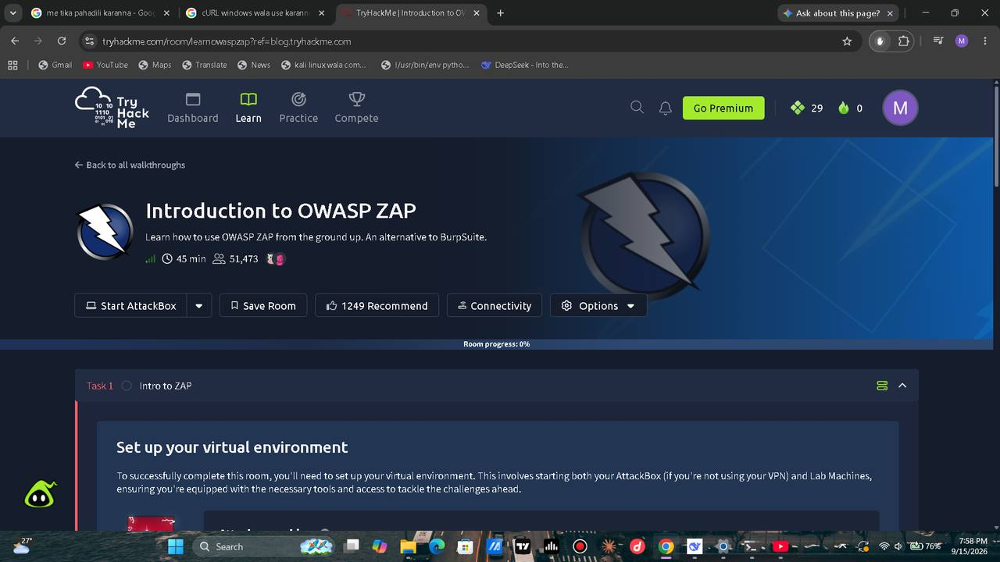

*TryHackMe — Introduction to OWASP ZAP room page*


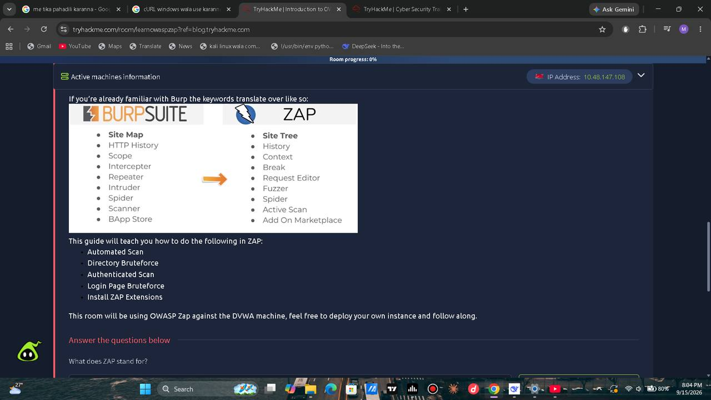

*Burp Suite ↔ ZAP feature-name mapping (Site Map↔Site Tree, Intruder↔Fuzzer, Intercepter↔Break)*


**Question:** "What does ZAP stand for?" → **Zed Attack Proxy** (සරිලන පිළිතුරක් ලෙස room එක confirm කළා).

---

## 3. Task 3/4 — Installation සහ Automated Scan

ZAP 2.17.0, Kali VM එකේ දැනටමත් install කරලා තිබුණා. පළමු වතාවට run කරද්දී ZAP session එක persist කරනවද (timestamp-based name එකකින්) කියලා අහනවා — recon session එකක් නම් persist කරන්න එක track කරගන්න පහසුයි.


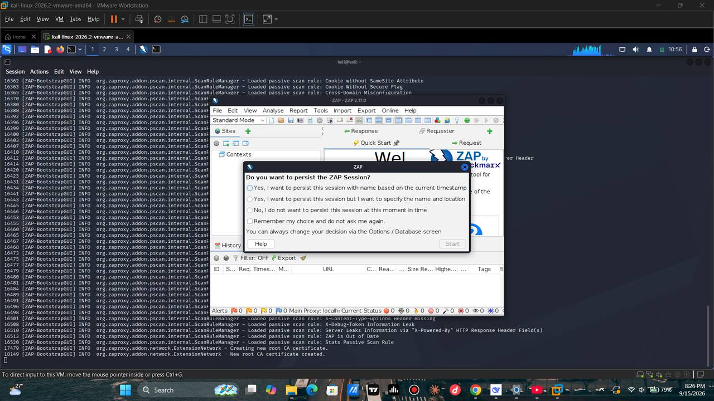

*ZAP පළමු වරට open කරද්දී — session persist කරනවද කියන dialog එක, සහ background log එකේ passive scan rules load වෙනවා*


Automated Scan screen එකෙන් `http://testfire.net` (Altoro Mutual — demo banking site) target කරගත්තා. `Use traditional spider` සහ `Use ajax spider` (Firefox සමඟ) දෙකම enable කරගෙන **Attack** ඔබලා scan එක ආරම්භ කළා.


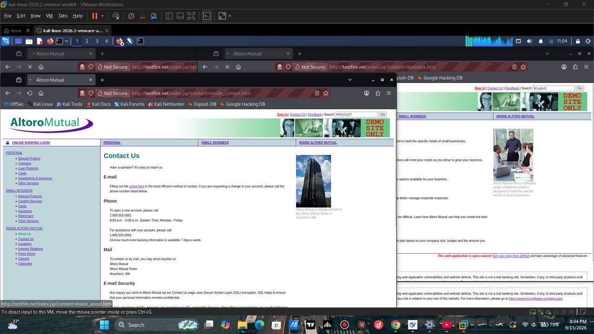

*Automated Scan — testfire.net එකට ajax spider එකෙන් content discover කරමින්, URLs 983ක් crawl කරලා*


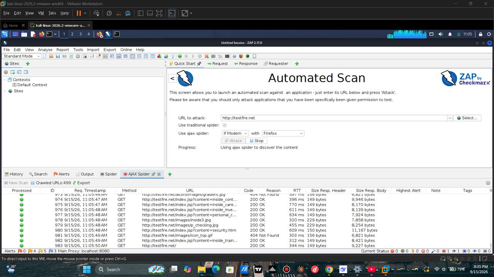

*testfire.net (Altoro Mutual) — Spider එකෙන් discover කරපු internal pages (Contact Us, Business) multiple tabs වල*


Scan එක complete වුණාට පස්සේ Alerts tab එකේ **Alerts (12)** categories පෙනුණා — ඒ අතර:

- Absence of Anti-CSRF Tokens (3)
- Content Security Policy (CSP) Header Not Set
- Missing Anti-clickjacking Header (Systemic)
- Sub Resource Integrity Attribute Missing
- Cookie without SameSite Attribute (4)
- Cross-Domain JavaScript Source File Inclusion
- Information Disclosure — Debug Error Message, Suspicious Comments
- Server Leaks Version Information via "Server" Header
- X-Content-Type-Options Header Missing (Systemic)


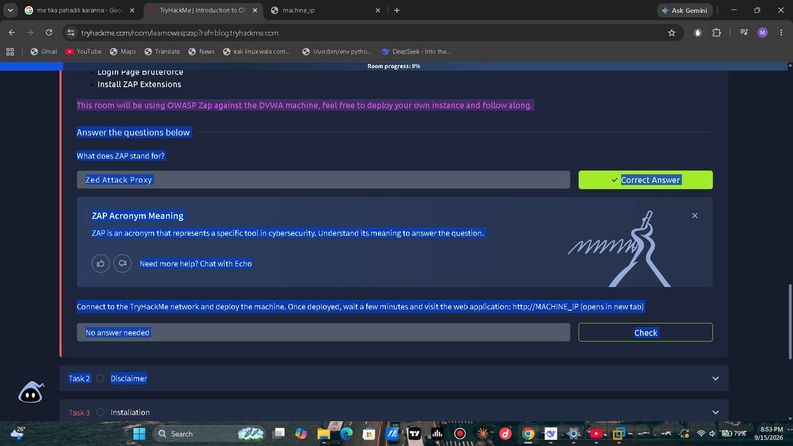

*Automated Scan අවසානයේ ලැබුණු Alerts (12) ලැයිස්තුව — testfire.net හි හැඳින ගත් web vulnerabilities*


මේ ඔක්කොම **passive scan rules** මගින් automatic ලෙස detect වුණු issues — ZAP කිසිම active exploit attempt එකක් නැතුව, හුදෙක් responses විශ්ලේෂණය කරලා මේ ගැටලු හඳුනාගත්තා. මේකම තමයි Automated Scan එකේ ප්‍රධාන වටිනාකම: manual recon කරන්න කලින් "low-hanging fruit" issues ඉක්මනින් හඳුනාගැනීම.

---

## 4. Task 2 — Disclaimer


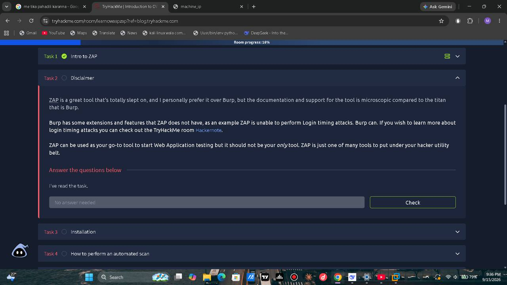

*Task 1 සම්පූර්ණයි (green tick) — Task 2: Disclaimer විවෘතයි*


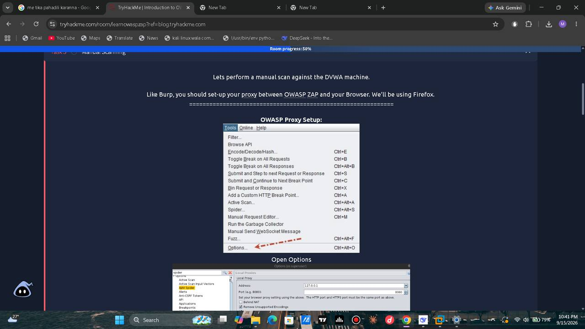

*ZAP ගේ limitations ගැන disclaimer — Login Timing Attacks වගේ දේවල් ZAP එකට කරන්න බැහැ, ඒ සඳහා Burp අවශ්‍යයි*


ZAP ගේ එක් සීමාවක් මෙහි අවධාරණය කරනවා: **Login Timing Attacks** — Burp Suite එකට කරන්න පුළුවන්, ZAP එකට බැහැ. ඒ නිසා ZAP එක "go-to" tool එක විදියට පාවිච්චි කරන්න පුළුවන් වුණත්, එය පුරාවටම එකම tool එක විය යුතු නැහැ — hacker utility belt එකේ එක් tool එකක් විතරයි.

---

## 5. Task 5 — Manual Scanning (Proxy + Certificate Setup)

DVWA machine එකට manual scan එකක් කරන්න කලින්, Burp එකේ "Intercept" කරන විදියටම ZAP එකත් browser එකේ proxy එකක් විදියට සකස් කරගන්න ඕන. මේ පියවර දෙකකින් සමන්විතයි:

### 5.1 ZAP එකේ Local Proxy සැකසීම


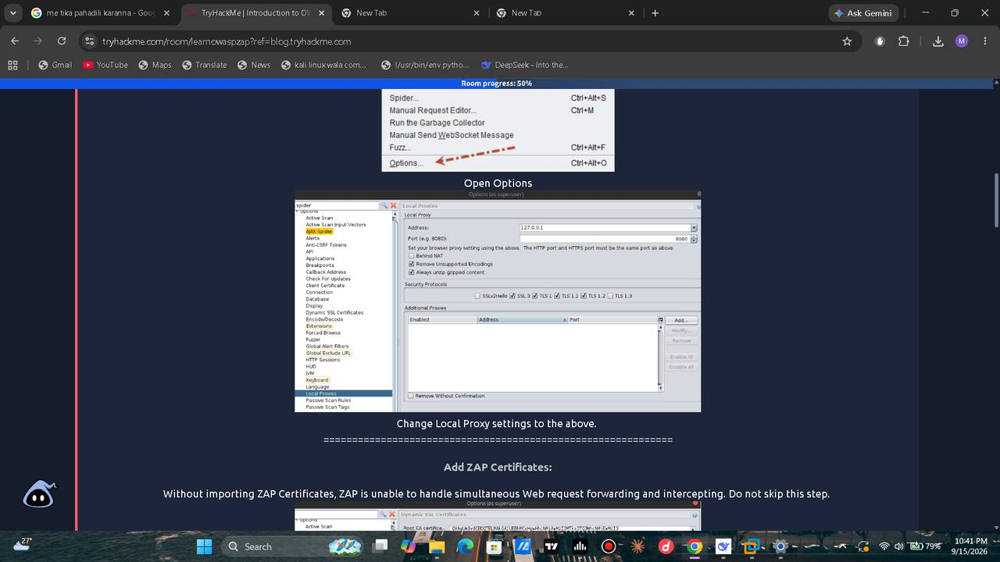

*ZAP → Tools → Options → Local Proxies — address 127.0.0.1, port 8080*


`Tools → Options → Local Proxies` යටතේ ZAP එක `127.0.0.1:8080` ලෙස listen කරන්න සකස් කළා (මෙය ZAP ගේ default proxy address/port එක).

### 5.2 ZAP Root CA Certificate එක Export කිරීම


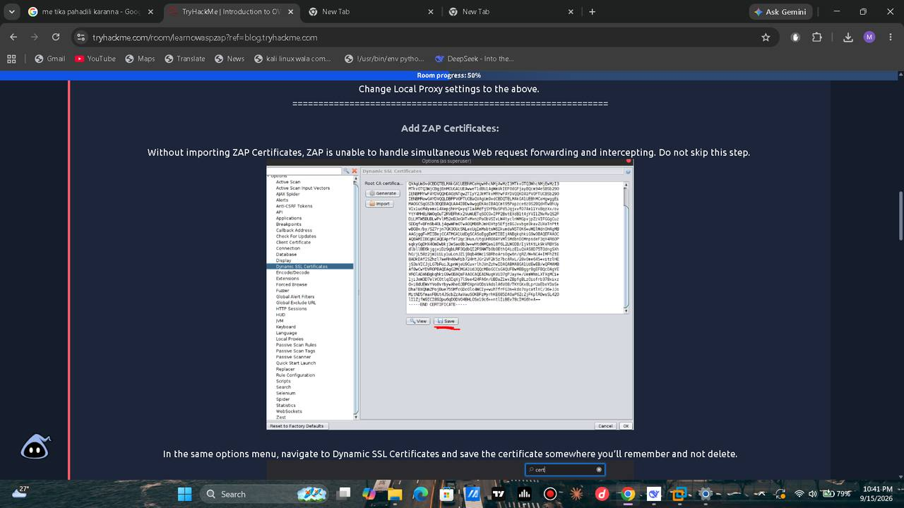

*Options → Dynamic SSL Certificates — ZAP ගේ Root CA certificate එක (PEM format) Save කිරීම*


HTTPS traffic intercept කරගන්න නම්, ZAP ගේ self-generated **Root CA certificate** එක browser එකට trust කරවන්න ඕන (නැත්නම් HTTPS sites load වෙන්නේ නැහැ, cert error එකක් එනවා). `Dynamic SSL Certificates` screen එකෙන් මේ certificate එක file එකකට save කරගත්තා.

### 5.3 Firefox එකට Certificate එක Import කිරීම


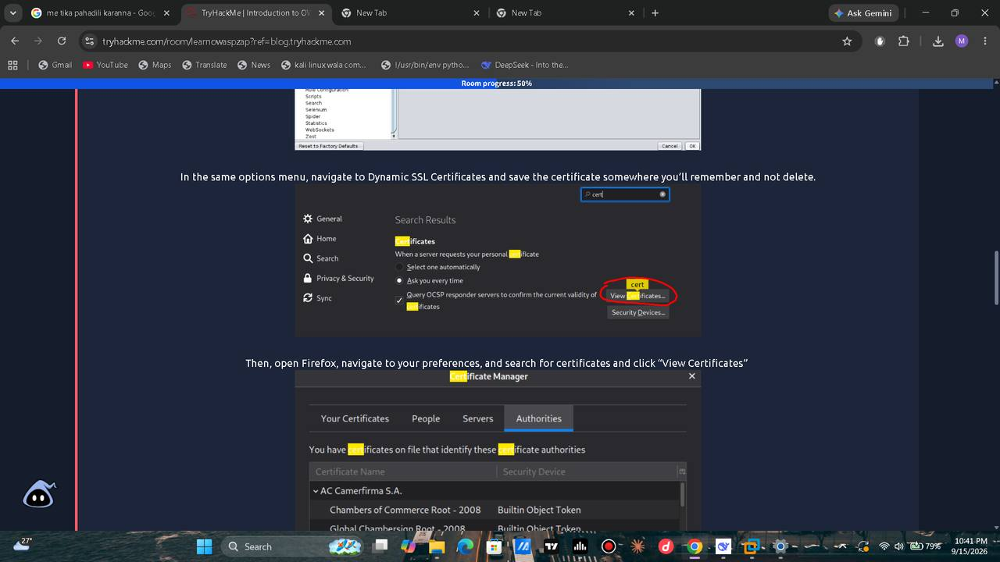

*Firefox → Settings → Certificates → View Certificates → Authorities tab*


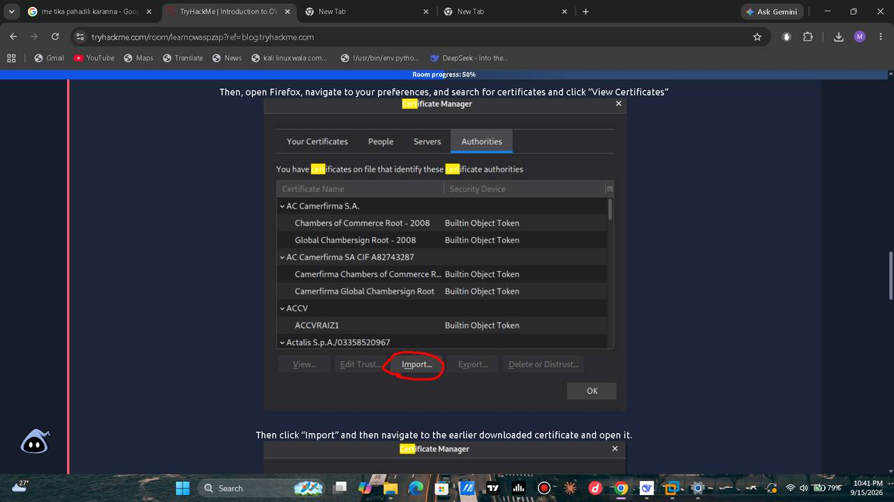

*Import කරපු certificate එක — "OWASP Zed Attack Proxy Root CA" trust කරන්න ඕන dialog එක, Trust this CA to identify websites + email users දෙකම check කරලා*


Firefox ගේ `Certificate Manager → Authorities → Import` හරහා, ZAP export කරපු certificate එක Firefox එකට import කළා, "Trust this CA to identify websites" සහ "email users" දෙකම tick කරලා. මේකෙන් Firefox එක ZAP ගේ self-signed certs trust කරනවා, HTTPS traffic intercept කරද්දී.

### 5.4 Firefox ගේ Manual Proxy Configuration


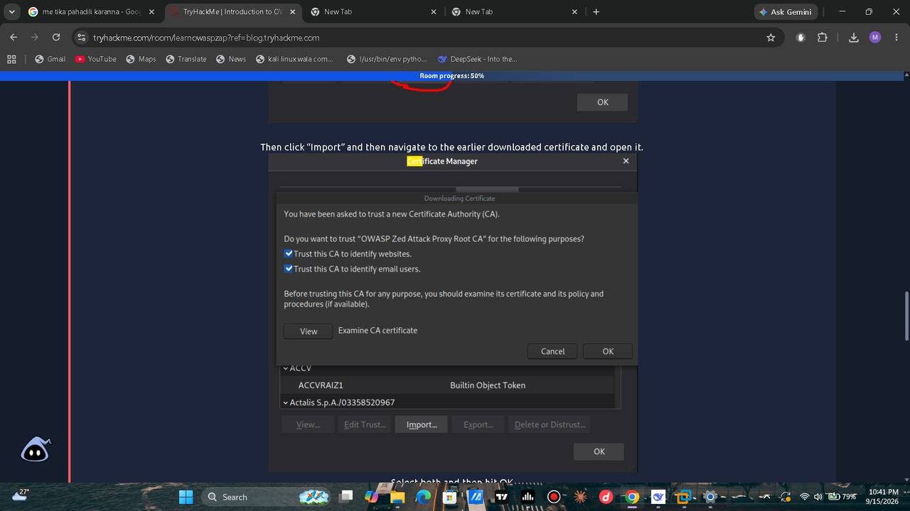

*Firefox → Settings → Network Settings → Manual proxy configuration (search "proxy")*


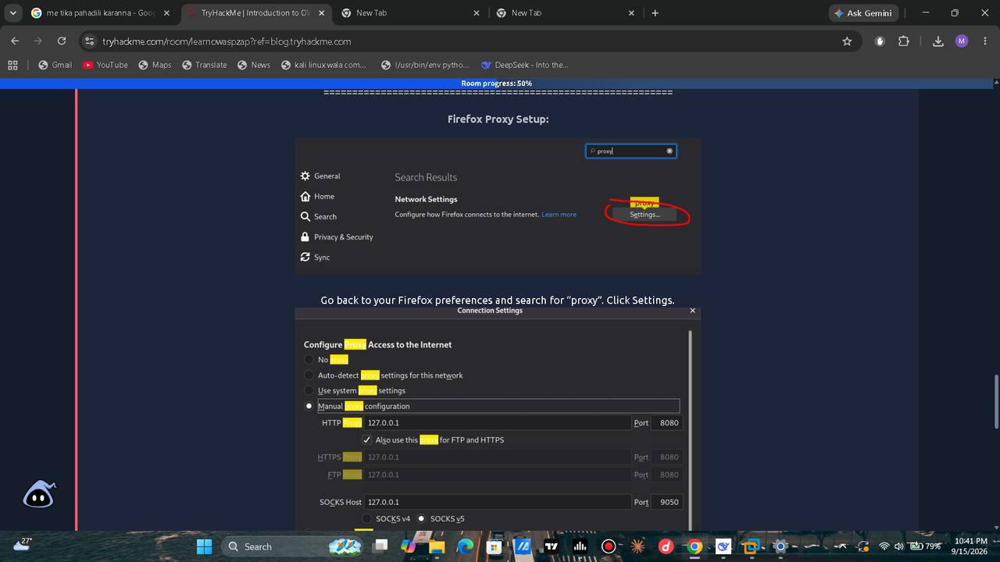

*Manual proxy configuration — HTTP Proxy 127.0.0.1:8080, "Also use this proxy for FTP and HTTPS" checked*


අවසානයේ Firefox ගේ `Network Settings` එකේ **Manual proxy configuration** තෝරලා, `HTTP Proxy: 127.0.0.1`, `Port: 8080` දමා, "Also use this proxy for FTP and HTTPS" checkbox එකත් tick කළා. මේකෙන් Firefox ගේ traffic ඔක්කොම ZAP හරහා route වෙනවා — ZAP ට browse කරන හැම request එකක්ම intercept/log කරන්න පුළුවන් වෙනවා.

> Room එකේ question එක: *"What IP do we use for the proxy?"* → පිළිතුර `127.0.0.1` (localhost — proxy software එක run වෙන්නේ එකම machine එකේ).

---

## 6. හමු වුණු ගැටලුවක් — DNS Resolution Failure


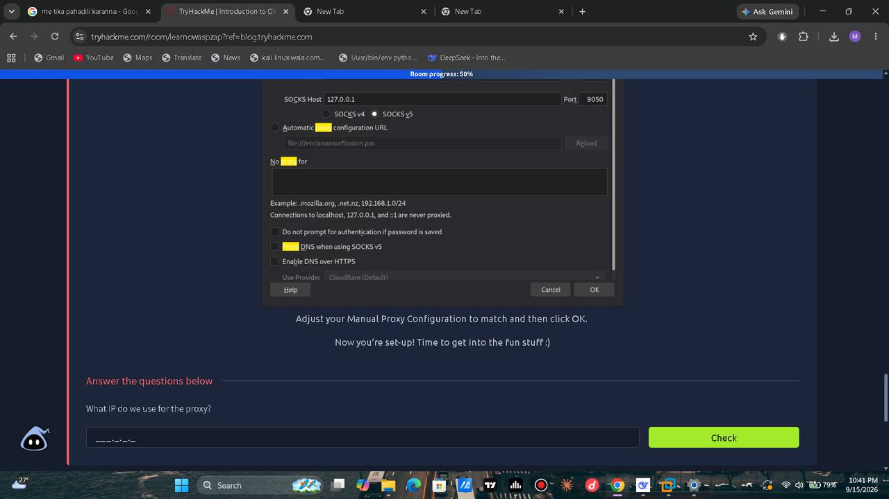

*පසුව Automated Scan එක නැවත testfire.net target කරගත් විට — "Temporary failure in name resolution" error එක*


දින කිහිපයකට පස්සේ (session අලුතින් start කරපු විට) Automated Scan එක testfire.net වෙත නැවත run කරන්න try කරද්දී:

```
Failed to attack the URL: host "testfire.com: Temporary failure in name resolution" not found,
please check that the URL you specify is c...
```

**හේතුව:** මේක DNS resolution failure එකක් — VM එකට domain name එක (testfire.net) IP address එකකට resolve කරගන්න බැරි වෙලා. මේකට පොදු හේතු කිහිපයක්:

- Browser proxy එක `127.0.0.1:8080` ලෙස set කරලා තියෙනකොට, Firefox ගේ DNS requests ZAP හරහා යන්න ඕන, ඒත් ZAP එක VM එකේ network connectivity නැති වෙලාවක run වුණොත් fail වෙනවා
- VM එකේ internet/DNS connectivity එක temporarily down වෙලා තිබෙන්න පුළුවන් (snapshot restore කරපු අලුත් session එකක්, network adapter reconnect වෙලා නැති එකක්)
- ZAP එකේම outbound connection options වල proxy chain එකක් misconfigure වෙලා තිබෙන්න පුළුවන්

මේ error එක ZAP ගේ bug එකක් නෙවෙයි — network/DNS layer එකේ ගැටලුවක්. VM එකේ `ping testfire.net` හෝ `cat /etc/resolv.conf` run කරලා DNS resolution එක manually verify කරන එක ඊළඟ debugging step එක වෙන්න ඕන.

---

## 7. ප්‍රධාන පාඩම් (Key Takeaways)

1. **ZAP = Burp Suite එකට නොමිලේ alternative එකක්**, Automated Scan, Spidering වගේ Burp එකේ paid features ටිකක් free-ම තියෙනවා.
2. **Automated Scan එකක් (Spider + Active Scan)** manual testing කරන්න කලින් low-hanging-fruit vulnerabilities ඉක්මනින් surface කරගන්න පුළුවන් (missing security headers, CSRF token absence, cookie flags).
3. **Manual scanning (proxy mode)** කරන්න කලින් steps දෙකක් අනිවාර්යයි: (1) ZAP එක local proxy එකක් විදියට configure කිරීම, (2) ZAP ගේ root CA certificate එක browser එකට trust කරවීම — නැත්නම් HTTPS traffic intercept කරගන්න බැහැ.
4. **ZAP එකේ සීමාවක්:** Login Timing Attacks වගේ attack types සඳහා තවමත් Burp Suite එකම අවශ්‍යයි — ZAP එකම "only tool" එක නොකරගත යුතුයි.
5. **DNS/network errors** security tool එකේ bug එකක් විදියට misread කරන්න එපා — proxy chain එකක් හෝ VM network adapter එකක් ගැටලුවක් තිබෙන්න පුළුවන් බව error message එක හොඳින් කියවලම තේරුම් ගන්න ඕන.

---

## 8. ඊළඟ පියවර (Next Steps — Room එකේ ඉතුරු Tasks)

- DNS error එක fix කරලා, Firefox proxy එක හරහා DVWA machine එකට manual browse කරලා ZAP ගේ History tab එකේ requests capture වෙනවද බලන්න
- **Task 6 — Directory Bruteforce:** ZAP ගේ Forced Browse (OWASP DirBuster wordlists) feature එකෙන් hidden directories/files සොයාගැනීම
- **Task 7 — Authenticated Scan:** DVWA login session එකක් ZAP ට assign කරලා, login-required pages වලටත් scan එක extend කිරීම
- **Task 8 — Login Page Bruteforce:** ZAP ගේ Fuzzer එකෙන් login form එකක් against password list එකකින් test කිරීම
- **Task 9 — Install ZAP Extensions:** Marketplace එකෙන් add-ons (උදා: additional scan rules) install කිරීම

---

*Disclaimer: මෙම lab එක TryHackMe ගේ intentionally-vulnerable demo targets (Altoro Mutual testfire.net, DVWA) මත, room එකේ ලබාදුන් authorized machine එකක් තුළ පමණක් සිදු කළ එකකි. Testfire.net IBM විසින් security testing training සඳහාම publicly ලබාදී ඇති demo site එකකි.*
